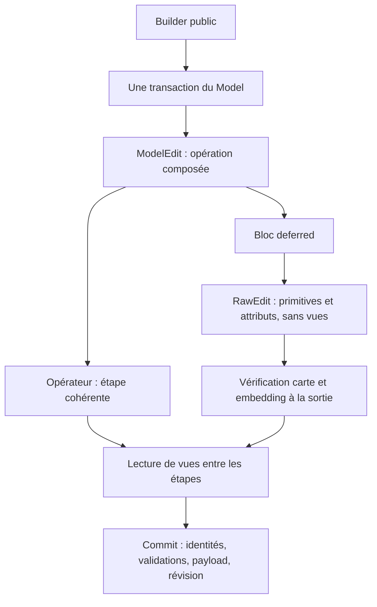

# Comprendre l’édition du Model : transactions, opérateurs et RawEdit

**Statut : revue historique, affinée après discussion.** Les défauts de validation
des solides et de coupe α3 sont corrigés, et les primitives brutes sont réservées
à `RawEdit` pour les builders. La direction retenue conserve les `expect`
justifiés et les invariants garantis par construction : aucune généralisation
des `Result` aux vues ni validation complète à chaque opérateur. Le contrat
courant est décrit dans [transactions.md](../transactions.md).

**Date : 5 novembre 2026.** Note de reprise et d’évaluation de l’architecture.
Elle décrit les changements de `b109143` à `9d54030`, puis le retrait de la
capture des paniques demandé à la suite de la revue. Les recommandations
ci-dessous ne sont pas toutes implémentées.

## 1. Où nous en sommes

La direction retenue est bonne : construire les opérations de modélisation avec
des **opérateurs qui préservent un état lisible**, et réserver les modifications
brutes complexes à des **blocs explicites sans vues**. La transaction englobe
toute l’opération et restaure le modèle sur une erreur explicite.

L’infrastructure existe et plusieurs builders ont migré. En revanche, la
séparation des capacités reste incomplète et deux défauts vérifiés concernent
encore la validation des solides modifiés et les connexions α3 de `cut_edge`.
Le fait que les tests existants passent ne suffit donc pas à déclarer le
contrat d’édition entièrement assuré.

Une décision est désormais explicite : **NGK ne capture pas les paniques**.
Un problème récupérable doit emprunter un chemin `Result::Err`. Une panique
appelle une correction de l’algorithme ou de l’API. Le modèle n’est pas garanti
réutilisable après une panique.

## 2. Les trois choses qu’une modification doit maintenir ensemble

Un `Model` contient plusieurs descriptions complémentaires de la forme :

| Élément | Exemple | Responsabilité |
|---|---|---|
| Carte combinatoire | darts et involutions α0…α3 | Connectivité des cellules brutes |
| Entités et géométrie | `VertexKey`, `EdgeKey`, supports et spans | Identité durable et signification géométrique |
| Étiquetage d’embedding | une 0-cellule appartient à l’intérieur d’une arête | Distinguer les cellules portant une entité des cellules de scaffold |

Une face logique n’est pas simplement une 2-cellule. Un cylindre peut avoir une
couture représentée dans la carte, sans que cette couture constitue une arête
de la forme visible. De même, un cercle sans sommet possède une 0-cellule de
fermeture, étiquetée comme intérieure à l’arête.

Les vues `Face`, `Edge`, `Profile`, `Sheet` lisent cette organisation. Pour
traverser correctement la forme, elles utilisent notamment un index dérivé
qui associe les darts à leurs propriétaires. **Cet index est un cache ;
l’étiquetage et les attributs restent les données de référence.**

## 3. Le problème initial : une transaction ne rend pas ses étapes lisibles

La transaction vérifiait le modèle à la fin. Les builders, eux, pouvaient
enchaîner des primitives puis lire une vue entre deux écritures.

Exemple conceptuel : réunir deux arêtes de faces voisines.

```text
1. Recoudre les darts des deux 1-cellules.
2. Déclarer quelle arête logique survit.
3. Déclarer quels sommets logiques fusionnent.
4. Régler les étiquettes des éventuelles fermetures de cercle.
```

Après la première étape, les 0-cellules des coins peuvent déjà être réunies,
alors que les attributs et les étiquettes décrivent encore deux situations
distinctes. Une lecture à cet instant peut rencontrer une contradiction :
une même 0-cellule porte un sommet et reste étiquetée comme scaffold d’une arête.

Le commit aurait pu refuser cet état. Mais une lecture intermédiaire essayait
déjà de construire l’index d’embedding, et pouvait paniquer avant ce commit.
Le sweep d’un disque et certains découpages booléens ont exposé ce défaut.

**Atomicité et lisibilité sont deux garanties différentes.** Restaurer le modèle
sur `Err` ne suffit pas à rendre les états intermédiaires utilisables par les vues.

## 4. Le rôle de chaque niveau



### La transaction : l’opération complète

Un builder public ouvre une transaction. Sa variante interne `_edit` reçoit
le `ModelEdit` existant. Les builders composés réutilisent ce même edit : une
seule sauvegarde, un seul journal de filiation, un seul commit.

Le commit réconcilie les identités, valide les invariants, applique la politique
de payload et incrémente la révision. Une erreur explicite à ces étapes restaure
le modèle initial. Les clés temporaires ne survivent pas nécessairement à la
réconciliation ; les déclarations de fusion déterminent les survivants.

### L’opérateur : une étape complète de modification

Les opérateurs actuels sont `mark_edge`, `cut_edge`, `sew_edges` et `unsew_edge`.
Ils regroupent des modifications qui doivent être pensées ensemble.

Par exemple, `sew_edges` recoud les cellules brutes, déclare les fusions
d’arêtes et de sommets et règle la propriété de la fermeture. Le builder n’a
plus à réinventer cette séquence à chaque extrusion, loft ou révolution.

Le contrat recherché est : préconditions vérifiées avant mutation, puis
cohérence topologique et d’embedding à la sortie. La géométrie reste en partie
à la charge du builder : `cut_edge` reçoit les courbes des deux morceaux et le
point de coupe. Les pcurves d’une face restent aussi à maintenir par l’appelant.
« Lisible après un opérateur » ne signifie donc pas « toute la modélisation et
tout le payload sont déjà validés comme après commit ».

### Le bloc différé : une chirurgie dont l’intérieur n’est pas lisible

Certains changements ne se décomposent pas utilement en petites étapes
cohérentes. Le blend détache des portions, insère de nouvelles cellules, recoud
et enregistre les nouvelles entités. Au milieu, des vues de la forme n’ont pas
de sens fiable.

`edit.deferred(|raw| …)` expose un `RawEdit` qui permet de modifier la carte et
les attributs stockés, mais ne donne pas accès au `Model` ni aux vues dérivées.
Les lectures nécessaires sont préparées avant d’ouvrir le bloc.

À la sortie, `validate_gmap` et la construction de l’index d’embedding vérifient
le résultat. Le bloc **n’est pas une sous-transaction** : il ne possède pas de
sauvegarde indépendante. Son erreur doit être propagée avec `?` pour que la
transaction englobante restaure l’ensemble.

## 5. Deux exemples pour retrouver les réflexes

### Marquer un cercle sans sommet

Un cercle sans sommet est une arête non marquée. Sa 0-cellule de fermeture est
du scaffold appartenant à l’arête. La marquer demande deux actions solidaires :
retirer cette étiquette et créer un sommet sur cette 0-cellule.

```rust
// Dans un builder disposant déjà de l’arête et du point calculé.
let vertex = model.transaction(|edit| {
    edit.mark_edge(edge_key, point)
})?;
```

Cela n’ajoute ni dart ni liaison. Le premier « cut » d’un cercle sans sommet
le marque ; une coupe suivante peut le séparer en deux arêtes. C’est un bon
opérateur : une intention précise, une règle d’embedding réutilisable et un
résultat exprimé par une clé.

### Retirer un sommet de fermeture importé de STEP

STEP peut matérialiser un sommet là où NGK veut une fermeture sans sommet.
Le builder identifie d’abord le sommet, son dart et l’arête concernée, puis
effectue le changement d’interprétation dans un seul bloc :

```rust
// vertex_key, closure_dart et edge_key sont déterminés avant ce bloc.
edit.deferred(|raw| {
    raw.remove_vertex(vertex_key);
    raw.own_cell(Dim::Zero, closure_dart, EntityOwner::Edge(edge_key));
    Ok::<_, ModelEditError>(())
})?;
```

Ce fragment illustre l’API actuelle, sous les préconditions de l’importeur.
Il ne constitue pas une fonction générale de suppression de sommet. Une lecture
comme `raw.face_unchecked(face_key).loops()` n’est pas disponible : le type
empêche cette dépendance à un embedding potentiellement incohérent.

## 6. Les paniques : ce qui a changé et pourquoi

La première implémentation capturait les paniques de la closure d’opération.
Si une faute de lecture avait été enregistrée, elle convertissait la panique
en cette erreur. Sinon, elle restaurait le modèle puis relançait la panique.
Le commit se trouvait hors de cette protection.

Deux problèmes de conception en découlaient. Une faute enregistrée ne prouve
pas qu’elle a causé toute panique ultérieure. Et cette protection donnait des
comportements différents selon que la panique survenait dans le builder ou
pendant la politique de payload.

La décision est de supprimer cette récupération, plutôt que de l’étendre :

| Situation | Contrat actuel |
|---|---|
| Entrée invalide ou configuration refusée | `Err`, restauration du modèle |
| Validation ou politique de payload retournant une erreur | `Err`, restauration du modèle |
| Faute de lecture enregistrée, puis retour normal de la closure | Erreur de transaction, restauration du modèle |
| Panique dans l’opération ou le commit | Propagation de la panique, aucune garantie de restauration ou de réutilisation |

Une panique n’est donc plus une manière indirecte de produire `ModelEditError`.
L’[ADR 0004](../../adr/0004-panics-are-not-recoverable-errors.md) formalise ce choix.

Une limite demeure : certaines vues infallibles enregistrent une faute puis
renvoient une réponse vide. Si le builder fait ensuite un `expect` sur cette
réponse, la panique se propage. Retirer la capture ne résout pas cette ambiguïté.
L’amélioration proposée est de rendre les lectures nécessaires à l’édition
explicitement faillibles, tout en rendant les états incohérents inaccessibles
hors des blocs bruts.

Une autre conception mérite d’être distinguée de la capture des paniques :
**éditer une copie séparée, puis la publier uniquement après un commit réussi**.
L’original ne reçoit alors aucune écriture avant le succès. Une panique peut se
propager sans avoir modifié cet original, sans être interceptée ni convertie
en erreur. Ce n’est pas le fonctionnement actuel et cela ne corrige pas la cause
de la panique. Si nous voulons une isolation plus forte, cette option est à
étudier en vérifiant le coût des copies, les caches, la filiation et la politique
de payload. Les effets externes d’une politique ne deviennent pas annulables
simplement parce que le modèle est isolé.

## 7. Ce qui est acquis, ce qui manque encore

Les migrations comprennent les coutures d’arêtes du sweep, du loft, de
l’extrusion et de la révolution ; les coupes d’arêtes ; des blocs différés dans
le scaffold, le blend, l’ajout à un profil, la suppression et l’import STEP.
Cela réduit la duplication de règles délicates et rend les phases de chirurgie
visibles dans le code.

Deux défauts ont été reproduits pendant la revue du 5 novembre, avant la présente
modification, et ne sont pas corrigés par le retrait du gestionnaire de panique :

**Un solide existant peut devenir ouvert et néanmoins committer.** En construisant
un bloc puis en appliquant `unsew_edge` à une arête dans une nouvelle transaction,
la transaction renvoie `Ok`, tandis que `validate_solid_orientation` renvoie
`SolidShellOpen`. La sélection des solides à vérifier surveille les nouveaux
solides, les déplacements des ancres de shells et certaines créations/fusions
de faces. Elle manque les modifications de connectivité seules.

**`cut_edge` oublie les connexions α3 non libres.** Sur une carte initialement
valide comportant ces connexions, l’opérateur renvoie `Ok` alors que les axiomes
de GMap sont brisés. Le commit peut les refuser ensuite ; cela ne respecte pas
le contrat d’un opérateur sûr entre deux lectures. Il faut recopier ces connexions
sur les nouveaux darts, ou refuser la configuration avant toute mutation.

Autres limites à garder en tête :

- Les primitives brutes restent accessibles sur `ModelEdit`. La séparation
  souhaitée est donc partiellement une convention de programmation.
- `check_consistent` vérifie l’index d’embedding ; il ne valide pas à lui seul
  les axiomes de la carte, la géométrie et les solides.
- La validation d’orientation des solides est activée par défaut avec
  `debug_assertions`, désactivée en release, y compris pour les tests release.
- Fermer un bloc différé parcourt la carte et reconstruit l’index. Un bloc par
  primitive multiplierait ce coût ; le bon périmètre est une chirurgie cohérente.
- Les tests « erreur ou solide valide » vérifient le confinement des échecs.
  Ils ne prouvent pas qu’une opération géométriquement légitime réussit.

## 8. Aurait-on pu faire autrement ?

| Possibilité | Intérêt | Limite pour NGK |
|---|---|---|
| Toutes les vues retournent `Result` | Erreur visible au point de lecture | N’empêche pas les écritures incohérentes ; complément utile |
| Lire uniquement le snapshot initial, puis appliquer un plan | Très adapté à une chirurgie préparée comme le blend | Un booléen doit aussi classifier les morceaux qu’il vient de créer |
| Valider après chaque primitive | Localisation immédiate du problème | Certaines séquences doivent traverser un état invalide |
| Ajouter des étapes validées ou des savepoints | Frontières explicites entre phases d’un gros algorithme | Une sauvegarde par phase n’est pas nécessaire si toute l’opération échoue ensemble |
| Éditer un modèle séparé, publier après succès | Préserve l’original sans capturer les paniques | Change la mécanique de transaction ; isolation et coût à vérifier |
| Mettre l’index à jour après chaque écriture | Peut éviter des reconstructions | Ne décide pas qui doit posséder les cellules ni quelle identité doit survivre |

Le meilleur compromis proposé reste **transaction globale + opérateurs + blocs
différés sans vues**. Les lectures faillibles complètent cette organisation.
Une séparation plus poussée par types, entre phase de lecture et phase brute,
serait une évolution de la même idée.

Il serait prématuré d’affirmer que c’est l’implémentation la plus performante.
Les coûts de reconstruction et de validation doivent être mesurés sur des
opérations représentatives avant d’introduire un index incrémental.

## 9. Ce que nous devrions faire ensuite

Ces recommandations constituent du travail restant ; le retrait de la capture
des paniques ne les réalise pas.

1. **Fermer les deux défauts vérifiés.** Ajouter les régressions exprimant le
   résultat attendu : ouverture d’un shell refusée au commit ; coupe préservant
   α3, ou refus préalable sans mutation. Pour les solides, une validation de tous
   les solides peut fournir un premier contrat simple avant un suivi ciblé fiable.
2. **Préciser les garanties des opérateurs.** Distinguer préconditions, état
   lisible après succès, responsabilité géométrique du builder et validation au
   commit. Si une vérification après mutation échoue, imposer la propagation de
   l’erreur à la transaction ; ne pas continuer comme après un refus préalable.
3. **Achever la séparation des capacités.** Réserver les primitives susceptibles
   de casser la cohérence à `RawEdit` et aux implémentations internes des
   opérateurs. Garder les vues sur la capacité d’édition cohérente.
4. **Éliminer les lectures ambiguës.** Étudier une API de lecture faillible pour
   les builders au lieu de leur donner une frontière vide quand elle est illisible.
   Une frontière vide légitime et une lecture impossible doivent être distinguables.
5. **Renforcer les critères de réussite.** Pour les cas géométriquement supportés,
   demander un solide valide avec des propriétés attendues : volume, orientation,
   conservation des clés et filiation. Garder les tests de refus pour les
   configurations effectivement non supportées.
6. **Créer les opérateurs à partir des usages récurrents.** Une insertion à
   travers une face ou une fusion de faces peut devenir un opérateur si plusieurs
   callers partagent la même règle. Une chirurgie spécialisée peut rester un bloc
   différé. Il n’est pas nécessaire de transformer chaque helper en opérateur.

## 10. Où reprendre dans le code

| Lecture | Ce qu’elle permet de retrouver |
|---|---|
| [CONTEXT.md](../../../CONTEXT.md) | Cellules brutes, entités, scaffold, clés et vocabulaire |
| [transactions.md](../transactions.md) | Contrat courant, composition et ordre du commit |
| [edit_operators.rs](../../../src/topology/edit_operators.rs) | Les quatre opérateurs et leurs préconditions |
| [edit_deferred.rs](../../../src/topology/edit_deferred.rs) | Capacités de `RawEdit` et vérifications à la fermeture |
| [model.rs](../../../src/model.rs) | Transaction, snapshot, fautes de lecture et caches |
| [edit.rs](../../../src/topology/edit.rs) | Filiation, réconciliation, validation des solides et politique de payload |
| [edit_operators.rs — tests](../../../tests/topology/edit_operators.rs) | Exemples exécutables des opérateurs et blocs différés |
| [edit_safety.rs — tests](../../../tests/topology/edit_safety.rs) | Reproductions des builders, propagation et fautes de lecture |
| [wsC-edit-safety.md](../../../plan/robustness/wsC-edit-safety.md) | Travail restant et audit des paniques |

Lors de la revue initiale, les 178 tests de topologie et les 192 tests STEP
passaient. Les sondes ciblées ont néanmoins exposé les deux défauts ci-dessus,
ainsi qu’une absence de rollback lors d’une panique de politique de payload.
Ce dernier point relève désormais du contrat explicite sans récupération.
La suite builders complète n’avait pas été validée : son exécution avait été
interrompue pendant un cas booléen long.

Après le retrait de la capture des paniques, les trois tests ciblés de lecture
en édition passent. La commande `cargo test --all-targets --all-features`
termine avec succès, y compris les 310 tests builders ; 74 tests de la suite
restent ignorés. `cargo clippy --all-targets --all-features` termine avec des
avertissements dans des zones non modifiées. `git diff --check` ne signale pas
d’erreur. Ces résultats valident le changement de contrat ; ils ne corrigent
pas les deux défauts exposés par les sondes de la revue.
