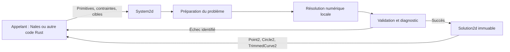

# Proposition d'architecture du solveur 2D

Statut : proposition acceptée, implémentée dans `src/solver/`. Ce document garde
le raisonnement de conception ; le contrat effectivement livré et ses limites
sont décrits dans [l'architecture du solveur](../docs/architecture/solver.md).
Les besoins retenus sont dans [solvers.md](solvers.md).

## 1. Une structure publique, dans NGK

Proposition : un module `ngk::solver` exposant principalement `System2d`.
Il possède les primitives, leurs paramètres, les contraintes et la dernière
solution. L'appelant ajoute, modifie, résout et lit les résultats sur cet objet.

Le module utilise les valeurs géométriques NGK et les bibliothèques mathématiques
déjà présentes. Son calcul ne dépend ni de `Model`, ni de GMap, ni de Nales.
L'import extrait les paramètres d'une valeur géométrique ; il ne conserve pas
de liaison mutable avec l'objet d'origine. La sortie fournit des valeurs NGK.



Construire un profil topologique à partir du résultat reste une opération
distincte. Une coïncidence numérique ne crée pas automatiquement un vertex ou
une couture dans NGK. Les correspondances avec les clés d'un `Model` appartiennent
à l'intégration appelante. Aucune crate séparée ni interface générique de noyau
géométrique n'est nécessaire pour cette première architecture.

## 2. Le parcours de l'API

Exemple de conception ; utiliser la documentation d'architecture pour l'API actuelle :

```rust
let mut system = System2d::new(SolveOptions::default());

let a = system.add_segment(segment_a)?;
let b = system.add_segment(segment_b)?;
let joint = system.add_constraint(Constraint2d::coincident(a.end(), b.start()))?;
system.add_constraint(Constraint2d::horizontal(a))?;
system.add_constraint(Constraint2d::length(a, 20.0))?;

let first = system.solve()?;
let moved = system.solve_toward(&[
    Target2d::point(b.end(), desired_position),
])?;
let solved_segment = moved.segment(a)?;

system.remove_constraint(joint)?;
let detached = system.solve()?;
```

Propositions de types publics :

| Type | Rôle |
| --- | --- |
| `System2d` | Système éditable, configurations et calcul réutilisable |
| `PointKey`, `SegmentKey`, `CircleKey`, `ArcKey` | Références typées aux primitives |
| `PointRef` | Point indépendant ou point caractéristique d'une primitive |
| `ConstraintKey`, `Constraint2d` | Identité et définition d'une contrainte |
| `Target2d` | Objectif temporaire d'un appel de résolution |
| `Solution2d` | Géométrie résolue immuable et rapport associé |
| `SolveOptions`, `SolveError`, `EditError` | Réglages et erreurs structurées |

`solve()` et `solve_toward(...)` retournent `Result<Solution2d, SolveError>`.
Les additions et éditions retournent des erreurs de référence, de type ou de
donnée invalide dès qu'elles peuvent être détectées sans résoudre le problème.
Une contrainte valide mais incompatible avec les autres peut être ajoutée ;
sa résolution échoue ensuite et permet d'identifier les relations à corriger.

Les mêmes opérations permettent une construction progressive ou par lots.
Un lot d'éditions est validé et appliqué ensemble, avec une correspondance
entre références locales du lot et clés du système. Cette facilité ne demande
pas un second modèle de données public.

## 3. Stockage : références stables, paramètres compacts

Proposition : des pools pour les primitives, les paramètres scalaires et les
contraintes. Les primitives référencent leurs paramètres ; les contraintes
référencent les primitives ou leurs points caractéristiques. Les paramètres
restent privés. Une table de correspondance les compacte dans un vecteur de
travail numérique lorsque la structure du problème change.

Ce stockage reprend l'idée de pools identifiés de la discussion. Il ne fige
pas une structure de tableaux pour chaque champ de chaque type. On commence
avec les conteneurs les plus simples, puis on mesure avant de spécialiser.

Les clés sont typées et générationnelles, avec une identité interne du système.
Cela permet de refuser une clé supprimée ou issue d'un autre système, même si
son emplacement numérique ressemble à une référence valide. Le solveur ne
réutilise pas les clés topologiques NGK et n'expose jamais les indices du vecteur.

Un `PointRef` conserve un rôle stable, par exemple `a.end()` ou `circle.center()`.
Il ne contient pas de copie de coordonnées. Les extrémités de primitives
différentes restent distinctes ; la coïncidence reste une contrainte retirable.
Une éventuelle élimination numérique ne fusionne pas leurs identités publiques.

Proposition de paramétrisation minimale :

| Primitive | Variables | Nombre |
| --- | --- | ---: |
| Point | x, y | 2 |
| Segment | x/y de chaque extrémité | 4 |
| Cercle | x/y du centre, rayon | 3 |
| Arc | x/y du centre, rayon, angle de départ, amplitude | 5 |

Pour l'arc, le sens est une donnée discrète conservée et l'amplitude est positive,
strictement inférieure à `2*pi`. Les extrémités sont calculées à partir de ces
cinq variables, tout en restant accessibles aux contraintes. On ne rajoute pas
de coordonnées indépendantes pour elles. Les angles internes peuvent être
déroulés pour traverser la coupure usuelle entre `-pi` et `pi` sans saut.

L'orientation du repère d'un cercle entier reste une donnée d'import/export,
sans degré de liberté géométrique artificiel. L'import/export des arcs conserve
leur sens et leur amplitude, y compris les arcs supérieurs à un demi-tour.

## 4. État éditable et dernière solution

La structure possède quatre responsabilités internes :

- Le problème : primitives, contraintes, références et révision.
- La configuration courante : valeurs initiales pour la prochaine résolution.
- La dernière solution : un résultat immuable rattaché à sa révision.
- L'espace de calcul : correspondances, composantes, matrices et allocations
  réutilisables, invalidées suivant le type d'édition.

| Action | Effet proposé |
| --- | --- |
| Ajout | Crée les références et les valeurs initiales des nouveaux objets |
| Modification | Conserve la clé et remplace les données explicitement modifiées |
| Édition invalide | Ne modifie rien |
| Résolution réussie | Publie ensemble configuration, solution et état de calcul valide |
| Résolution échouée | Conserve la configuration de départ et la dernière solution ; les éditions antérieures restent présentes |

Chaque modification effective et validée de primitive ou de contrainte augmente
la révision du problème. Un lot atomique l'augmente une fois. Une édition invalide
ou sans changement et la publication d'un succès numérique ne l'augmentent pas.

Un objet ajouté après le dernier succès n'existe pas dans l'ancien résultat.
Il démarre avec ses propres valeurs, au lieu d'être écrasé par une restauration
globale de l'ancienne solution. Changer de catégorie de primitive exige de
supprimer puis d'ajouter ; une mise à jour de segment conserve ses rôles début/fin.

`solution()` fournit un résultat seulement si la révision courante a été résolue.
`last_solution()` donne le dernier succès, avec sa révision, même si le problème
a été modifié depuis. Le snapshot possède sa géométrie et se consulte sans
passer par le système actuel. Un objet supprimé depuis peut donc encore y être
lu comme donnée historique. Le système ne conserve qu'un dernier snapshot ;
l'appelant peut garder d'autres valeurs `Solution2d` s'il en a besoin.

Les cibles temporaires ne changent pas la révision du problème. Un numéro de
résolution distingue plusieurs configurations obtenues pour cette même révision.
Un appel échoué ne publie pas non plus les nouveaux choix de branche de son essai.

Proposition de suppression : refuser par défaut une primitive encore référencée
en retournant les contraintes dépendantes. Une option de cascade explicite
supprime ces contraintes et retourne la liste des éléments retirés. Une opération
atomique suffit ; aucun historique complet d'annulation n'est imposé au solveur.

## 5. Sémantique proposée des contraintes

Les familles sont acceptées ; cette table précise une première API à valider.

| Famille | Combinaisons et convention proposées |
| --- | --- |
| Coïncidence | Deux `PointRef`, dont les coordonnées restent distinctes |
| Point sur courbe | Point sur droite support ou cercle support ; aucune restriction au span |
| Horizontal / vertical | Segment, ou paire de points pour aligner leurs coordonnées |
| Distance | Deux points ; point et droite support avec distance positive |
| Écart x/y | Différence signée entre deux points ordonnés |
| Longueur / égalité | Longueur de segment ; égalité de longueurs de segments |
| Rayon / diamètre / égalité | Cercles et arcs, y compris égalité entre cercle et arc |
| Parallèle / perpendiculaire | Deux directions de segments non dégénérés |
| Angle | Deux segments dirigés du début vers la fin ; radians |
| Concentricité | Centres de cercles et d'arcs |
| Milieu | Un point est le milieu d'un segment ou d'une paire de points |
| Symétrie | Deux points symétriques par rapport à une droite support ou à un point |
| Blocage | Fixe les coordonnées d'un point ou tous les paramètres géométriques d'une primitive |
| Tangence | Droite/cercle et cercle/cercle, en utilisant les supports des segments/arcs |

L'angle sans signe par défaut est compris entre `0` et `pi`. Une cible `alpha`
accepte les angles orientés `+alpha` et `-alpha`. L'angle orienté impose une
rotation modulo un tour. Inverser les extrémités d'un segment change sa direction
et peut donc changer sa cote ; il ne s'agit pas du plus petit angle entre deux
droites non orientées. Une branche locale, guidée par la configuration courante,
évite les bascules arbitraires sans prétendre rendre la solution unique.

Pour la tangence cercle/cercle, modes intérieur, extérieur et automatique. Le
mode automatique compare les deux conditions dans la configuration d'ajout ;
il conserve ensuite son choix. Proposition déterministe pour une égalité :
préférer l'extérieur et exposer le mode retenu dans le diagnostic. En intérieur,
le plus grand rayon initial désigne le cercle contenant ; à rayons égaux, le
premier argument le désigne. Cette identité est ensuite conservée. L'appelant
peut désigner explicitement le contenant, changer le mode ou demander un nouveau
choix automatique après une modification.
Des cercles confondus ne constituent pas un contact tangent isolé valide.

La tangence de deux supports ne les oblige pas à se rencontrer aux extrémités
de leurs spans. Un raccord segment/arc se décrit par coïncidence des extrémités
et tangence. Une aide de construction peut ajouter les deux et rendre leurs
deux clés, pour que l'appelant puisse les retirer séparément.

Un blocage capture les valeurs au moment de son ajout. Une référence extérieure
peut être importée puis bloquée ; son rafraîchissement est explicite. Une édition
de géométrie ne déplace pas silencieusement les valeurs d'une contrainte de blocage.
Ce mécanisme suffit au calcul sans introduire des dépendances entre documents.

La symétrie d'objets complets, les longueurs d'arc, les expressions entre cotes,
les cotes de référence et la sérialisation peuvent être ajoutées sans changer
la frontière du module. Elles ne sont pas implicitement promises par la table.

## 6. Résolution locale et déplacements

Proposition numérique : un moteur local à région de confiance, avec restauration
de faisabilité et objectifs secondaires. Les contraintes permanentes ont priorité.
Les cibles guident le déplacement ; la proximité de la configuration de départ
sert à départager les mouvements encore libres.

Ordre du calcul :

1. Valider les références, données et domaines des primitives.
2. Préparer le vecteur de paramètres, le graphe de dépendances et ses composantes
   indépendantes ; associer chaque équation à sa contrainte d'origine.
3. Recentrer et mettre à l'échelle les inconnues et résidus.
4. Restaurer la satisfaction des contraintes permanentes depuis la configuration
   courante, avec pas amortis et contrôle de validité géométrique.
5. Si des cibles existent, réduire leur erreur dans les directions encore libres,
   avec correction de faisabilité après les pas non linéaires.
6. Vérifier toutes les contraintes permanentes et la géométrie dans les unités
   d'origine, calculer le rapport, puis publier atomiquement le résultat.

On conserve le meilleur candidat admissible rencontré. Une cible inaccessible
ne rend pas le problème incompatible : elle laisse une distance résiduelle
dans le rapport. Si l'amélioration de la cible s'arrête, le candidat admissible
peut être retourné avec un statut de cible non atteinte ou de budget épuisé.
Sans candidat admissible, l'appel échoue et la dernière solution reste disponible.

Les cibles initiales portent sur les `PointRef`. Pour déplacer une primitive
entière, l'appelant peut fournir plusieurs cibles. Une cible sur un point évalué
d'une courbe peut compléter l'API pour saisir l'intérieur d'un segment ou le bord
d'un cercle : sa position paramétrique est fixée pour l'appel, sans créer une
contrainte permanente. Ce complément et la pondération des différentes cibles
doivent être validés sur des exemples de déplacement avant de figer l'ergonomie.

### Voie numérique recommandée

- Résidus et dérivées analytiques locales pour le petit catalogue. Les dérivées
  des points calculés d'un arc passent par la règle de chaîne.
- Correction amortie de faisabilité, puis pas de Gauss-Newton contraint/SQP
  à égalités pour les cibles. Les pas secondaires utilisent les directions
  libres et une correction de faisabilité ; ils ne reposent pas sur de simples
  poids élevés attribués aux contraintes permanentes.
- Structure creuse des dépendances et assemblage local dès le départ. Une
  factorisation dense par composante fournit une première référence ; SVD pour
  les rangs déficients, puis QR révélateur de rang ou méthodes creuses selon
  les mesures. `nalgebra` est déjà une dépendance de NGK.
- Les paramètres constants peuvent être éliminés en conservant leur origine.
  Une dépendance détectée dans le Jacobien réduit seulement le système
  linéarisé courant ; elle est réévaluée au fil des itérations et ne supprime
  pas durablement une contrainte non linéaire. Toutes les contraintes restent
  traçables et revérifiées. Éviter de former systématiquement des équations
  normales qui aggraveraient le conditionnement.

Cette hiérarchie a un précédent observable dans le chemin de résolution à deux
systèmes de [FreeCAD](https://github.com/FreeCAD/FreeCAD/blob/d3f4da791daa9e94f340b81770d13f090ec679c6/src/Mod/Sketcher/App/planegcs/GCS.cpp#L4530-L4694).
Les [méthodes à contraintes de SciPy](https://docs.scipy.org/doc/scipy/reference/optimize.minimize-trustconstr.html)
documentent notamment les projections QR/SVD. Le traitement des systèmes
linéarisés de [SolveSpace](https://github.com/solvespace/solvespace/blob/30e1c3ac0beb77fe3e098315b1bb662840ddc99a/src/system.cpp#L273-L317)
éclaire le choix de factorisation. Ces références orientent la conception ;
elles ne constituent ni une dépendance Python/C++, ni une mesure de performance NGK.

La formulation des résidus mérite un essai ciblé : une distance nulle au carré
et un angle exprimé seulement par cosinus peuvent perdre des dérivées utiles.
La coïncidence utilise deux écarts de coordonnées ; les angles utilisent une
branche locale adaptée, notamment près de zéro et d'un demi-tour.

## 7. Rapport et erreurs

Proposition : séparer le succès de résolution, la liberté restante et les
avertissements, car un système peut être sous-contraint et redondant à la fois.

Un rapport réussi contient : révision, numéro de résolution, estimation locale
des degrés de liberté, diagnostics de redondance, résidus par contrainte et état
des cibles. Il distingue une redondance établie structurellement d'une dépendance
locale et numérique. Même toutes les lignes dépendantes d'une contrainte peuvent
refléter une singularité ; ce seul constat ne justifie pas d'en proposer le
retrait. Les dépendances partielles d'une contrainte à plusieurs équations sont
également distinguées des dépendances portant sur l'ensemble de ses équations.

Erreurs proposées :

| Erreur | Information retournée |
| --- | --- |
| Donnée ou référence invalide | Primitive/contrainte concernée et raison |
| Conflit établi | Contraintes impliquées et nature du diagnostic |
| Non-convergence | Contraintes non satisfaites, résidus et raison d'arrêt |
| Géométrie dégénérée | Primitives ou relations devenues indéfinies |

Un échec numérique seul ne prouve pas un conflit. Les références retournées
peuvent décrire un conflit établi, une dépendance locale, ou un groupe suspect :
le rapport distingue ces niveaux. L'identification d'un groupe minimal de
contraintes contradictoires n'est pas garantie. Des diagnostics approfondis
par retrait/résolution peuvent être proposés sur demande, avec un budget séparé.

Le nombre de degrés de liberté provient du rang local, avec un seuil numérique
explicite. Il décrit la configuration analysée ; une singularité peut empêcher
de l'interpréter comme le nombre de mouvements finis réellement possibles.
Les contraintes temporaires de déplacement n'enlèvent pas de degrés de liberté
au diagnostic du problème permanent. Les relations de blocage en enlèvent.

## 8. Validité, unités et coûts

Recommandation initiale : coordonnées et valeurs finies, segments non nuls,
rayons positifs, arcs dans le domaine accepté. Les objets de dessin provisoires
de longueur nulle restent chez l'appelant jusqu'à leur définition valide.
Une étape numérique invalide est raccourcie ou rejetée ; aucune modification
silencieuse du rayon ou de l'amplitude n'est publiée pour masquer l'échec.

Les longueurs utilisent une unité cohérente choisie par l'appelant, les angles
des radians. Les tolérances linéaire et angulaire, seuil de rang et budgets
d'itérations sont séparés. Les tolérances géométriques NGK servent de référence ;
elles ne remplacent pas la normalisation d'un système mêlant longueurs et angles.

L'ordre de compilation est stable et aucun redémarrage aléatoire n'est effectué
par défaut. Une recherche plus large exige une demande explicite, conserve la
priorité des contraintes permanentes et signale le changement de configuration.
Le déterminisme visé porte sur un même environnement et les mêmes données ;
l'identité bit à bit entre plateformes n'est pas promise.

La cible est quelques centaines de primitives, avec quelques milliers dans des
cas rares. Mesurer séparément préparation, résolution ordinaire, déplacement
répété et diagnostic approfondi. Inclure une grande composante connectée :
plusieurs petits problèmes indépendants ne suffisent pas à valider cette échelle.
La latence admissible doit être confrontée aux mesures avant de qualifier la
résolution d'interactive. Le scénario connecté de `tests/solver/scale.rs`
mesure résolution et déplacement ; il ne représente pas tous les problèmes non linéaires.

## 9. Répartition du code proposée

```text
src/solver/
  mod.rs             déclarations et réexports
  system.rs          API et publication des configurations
  keys.rs            clés et références aux points
  primitives.rs      paramètres, validation, conversion géométrique
  constraints.rs     définitions et validation des relations
  solution.rs        snapshots et rapports
  error.rs           erreurs structurées avec thiserror
  options.rs         tolérances et budgets
  numerical/
    mod.rs           déclarations privées
    prepare.rs       composantes, indices, origine des équations
    residuals.rs     équations et dérivées
    solve.rs         région de confiance et priorités
    diagnose.rs      rang, redondances, conflits
tests/solver/         scénarios et propriétés du contrat public
```

Ce découpage reste proportionné au code réel : ne créer les fichiers qu'avec
leur première responsabilité concrète. Il n'introduit pas un framework de
solveurs génériques ni une infrastructure pour le solveur rigide écarté du scope.

## 10. Ordre de réalisation proposé

1. Vérifier la voie numérique sur des cas représentatifs : sous-contrainte,
   redondance, conflit, déplacement sur cercle et arc majeur. Comparer les
   dérivées à une approximation indépendante ; mesurer les cas connectés.
2. Livrer une première tranche de l'API avec références, snapshots, points et
   segments, coïncidence, blocage et dimensions, puis compléter cercles et arcs.
3. Compléter le catalogue accepté, les cibles et les diagnostics ; vérifier
   détachement des coïncidences, modes de tangence et angles des deux côtés.
4. Exercer les éditions répétées, les références périmées, les échecs suivis de
   réparation, les écarts d'échelle et les singularités.
5. Valider les performances et optimiser les composantes coûteuses. Décrire
   l'architecture effectivement implémentée dans `docs/architecture/` au fil
   des changements, avec les contrôles Rust requis par le dépôt.

Critères observables : les contraintes permanentes sont satisfaites à la
tolérance annoncée ; la sous-contrainte est un succès ; la redondance compatible
est un avertissement ; une cible hors d'atteinte ne casse pas les contraintes ;
un échec préserve les configurations publiées ; les diagnostics retrouvent les
références utilisateur ; l'import/export conserve la géométrie et le sens des arcs.

## État de réalisation

Le module Rust fournit les quatre primitives, le catalogue de contraintes,
les éditions atomiques, les snapshots, les cibles temporaires et les diagnostics.
Le calcul utilise des dérivées analytiques par différentiation automatique,
une réduction affine et des corrections SVD par composante. Les relations sont
revérifiées sur les coordonnées finales, y compris après dénormalisation.

Les tests couvrent les étapes fonctionnelles ci-dessus et un cas connecté à
l'échelle de centaines de segments. Une qualification des performances sur des
esquisses non linéaires variées reste distincte de cette première mesure.
Les diagnostics approfondis par retrait/résolution, les redémarrages explicites,
le cache de factorisation et une voie creuse ne sont pas exposés par cette API.
L'appelant peut modifier la configuration initiale et relancer le calcul local.
